# Labirintos com chaves e redes de avaliações

## Labirintos com chaves e redes de avaliações

Teoria dos Grafos e Análise e Visualização de Dados - 2026.2
Grupo G1 - Turma 5B

Integrantes informados: Artur Antunes; Ricardo Machado; Victor Uen; Luca Ribeiro; Pedro Ferraz.

Material integralmente gerado com assistência de IA (OpenAI Codex), incluindo código, mapas, soluções, demonstrações, análise, seleção das visualizações e texto. O enunciado proíbe vários desses usos. Este documento não demonstra conformidade acadêmica nem comprova participação, domínio ou autoria humana dos integrantes.

### Resumo

A Parte 1 representa labirintos como grafos dirigidos de estados e compara alcance, número de passos e custo. A Parte 2 aplica os mesmos quatro algoritmos ao arquivo recebido da rede Bitcoin Alpha, preservando sua versão. Os resultados diferenciam três respostas: caminho finito, destino inalcançável e inexistência de mínimo por ciclo negativo.

Foram processados dez mapas e uma variante de regra. Na Parte 2, foram preservados 24185 registros e 3782 usuários; os tempos são medições locais com 5 repetições por tarefa.

### Como ler

O manual vem primeiro. Em seguida estão a modelagem, as tabelas dos mapas, as cinco figuras da Parte 1, os experimentos e as oito figuras da Parte 2. A seção final responde à pergunta de pesquisa e registra limites e participação não comprovada.

### Situação acadêmica

Artur informou que o dataset foi aprovado. Essa informação não equivale a comprovante documental de aprovação. A produção integral com IA excede os usos permitidos pelo enunciado. A declaração anexa é apenas uma minuta não assinada e não substitui o modelo da professora. Este material requer revisão humana real e decisão das docentes antes de qualquer uso como entrega.

## 1. Manual de execução

Requisito: Python 3.11 ou superior. Execute os comandos na raiz do repositório. A implementação usa lista de adjacência própria; heapq auxilia Dijkstra. Bibliotecas prontas de algoritmos não participam da execução de src/.

```text
python -m venv .venv
.venv\Scripts\Activate.ps1
python -m pip install -r requirements-dev.txt
python -m pytest -q
python -m src.cli --all --repeticoes 5
```

A execução completa gera as duas partes, imagens, CSV/JSON, HTML interativo e os documentos em docs/. Benchmarks têm custo local variável, sobretudo Bellman-Ford. --no-render permite produzir apenas os dados; --report regenera os documentos de resultados já existentes.

```text
python -m src.cli --report
python -m src.cli --all --no-render --repeticoes 5
```

### Consultas e comparação de regras

```text
python -m src.cli --mapa data/mapas/m03_tres_chaves.txt \
  --alg DIJKSTRA --out out/consulta
python -m src.cli --mapa data/mapas/m06_fonte.txt \
  --alg BELLMAN_FORD --fonte-consumivel --out out/fonte
python -m src.cli --mapa data/mapas/m04_esteiras.txt \
  --armadilhas --interactive --out out/consulta
python -m src.cli --dataset data/dataset_parte2 --alg DIJKSTRA \
  --source 1 --target 638 --out out/consulta_dataset
```

As barras invertidas no fim das linhas acima indicam continuação visual: no PowerShell, digite cada comando em uma linha, ou use o acento grave como continuação. O README contém exemplos em uma linha.

### Usar a apresentação interativa

Abra out/parte1/labirinto_interativo.html no navegador. Escolha mapa e algoritmo, inicie ou avance manualmente, ajuste a velocidade e acompanhe posição, chaves, bônus e custo. Use o filtro de camada e a marcação de armadilhas. Casos RECUSA, CICLO_NEGATIVO e SEM_SOLUCAO são resultados e não devem aparecer como percurso de menor custo válido.

Um mapa surpresa pode ser salvo como TXT e passado a --mapa. Linhas de comentário começam com ponto e vírgula. Erros de grade, símbolos, número de inícios ou ausência de saída encerram a consulta com mensagem.

## 2. Representação do labirinto

G_pos contém uma casa livre por vértice. G_est contém estados (linha, coluna, K, B): K é o conjunto de chaves adquiridas; B identifica os bônus consumidos. Coordenadas começam em zero. O rótulo (1,1)|a|{0} indica chave a e bônus 0 já coletado. A mesma posição em dois conjuntos K/B corresponde a vértices diferentes.

| Símbolo | Regra e custo de entrada |
| --- | --- |
| # | Parede; sem vértice transitável. |
| . / S / G | Custo 1; S é único; G encerra o jogo. |
| , / ~ | Lama custa 3; água custa 5. |
| a..d / A..D | Chave custa 1 e permanece; porta custa 1 e exige a chave correspondente. |
| > < ^ v | Entrada custa 1; a saída do estado só segue a seta. |
| + | Primeira entrada custa -4; seguintes custam 1, registrando consumo em B. |
| * | Regra original: -2 em toda entrada. Variante: -2 uma vez e 1 depois. |

A construção explora apenas estados alcançáveis a partir de S e testa vizinhos em N, L, S, O. O custo pertence à casa de destino. Depois de entrar em uma chave ou bônus, atualiza a memória antes de identificar o novo estado. Não são pré-geradas todas as combinações possíveis.

### Direção, término e nó virtual

Esteiras impedem o retorno por um arco espelhado; coletar uma chave ou um bônus também muda a memória sem operação inversa. Um grafo não dirigido criaria movimentos que o jogo não permite. G não tem movimentos físicos de saída. De cada estado em G sai somente um arco virtual de custo zero para ALVO.

Os algoritmos buscam ALVO. Ordem, tamanho, densidade e graus do mapa excluem ALVO e seus arcos. A contagem de passos físicos também exclui o arco final. Como todo percurso de sucesso inclui exatamente um arco virtual, BFS preserva a escolha por menor quantidade de movimentos físicos.

O teto é F × 2^k × 2^b, sendo F casas livres, k chaves e b bônus. A variante consumível conta fontes como itens de memória. A ocupação é |V_est|/teto; a densidade dirigida é |E|/[|V|(|V|-1)], ou zero quando |V|<2.

## 3. Um mapa mínimo conferido à mão

```text
#######
#S.aAG#
#######
```

A grade tem 3 × 7, dentro do limite 5 × 7. As únicas posições livres são (1,1) a (1,5). Não há bônus. Inicialmente K é vazio. É possível ficar nas colunas 1 e 2 sem chave; entrar na coluna 3 coleta a. Portanto não existe estado na coluna 3 sem a, e a porta da coluna 4 é inacessível sem a.

| Memória | Estados físicos alcançáveis | Quantidade |
| --- | --- | --- |
| K vazio | (1,1)\|-\|{} e (1,2)\|-\|{} | 2 |
| K={a} | Colunas 1, 2, 3, 4 e 5 da linha 1, todas com a | 5 |
| Total | 2 + 5 | 7 |

### Enumeração dos dez arcos físicos

Sem chave há 1→2 e 2→1, além de 2→3 com mudança de memória: 3 arcos. Com a há 1↔2, 2↔3, 3↔4 e 4→5: 7 arcos. Não existe 5→4, pois a coluna 5 é G e o jogo terminou. O arco 2→3 sem a e o arco 2→3 com a saem de estados diferentes.

| Convenção | Vértices | Arcos |
| --- | --- | --- |
| Somente estados e movimentos físicos | 7 | 10 |
| Incluindo ALVO e G→ALVO | 8 | 11 |

O caminho BFS é S(1) → chão(2) → a(3) → A(4) → G(5) → ALVO. São quatro movimentos físicos, custo 1+1+1+1=4. A distância BFS até ALVO é cinco arcos, mas o relatório exporta quatro passos físicos.

Essa contagem é independente do programa e funciona como caso de verificação: o teste deve confirmar 7 estados físicos/10 arcos, ou 8 nós/11 arcos com ALVO. Também deve confirmar que a coleta altera a camada e que uma esteira direcionada à parede não ganha saída artificial.

O mapa mínimo serve para validar a representação. Ele não substitui os dois mapas próprios do grupo, que têm requisitos adicionais.

## 4. Métricas globais de todos os cenários

Cada linha usa as definições da seção 2. G_pos trata portas como chão para permitir a comparação geométrica; os movimentos de esteira e o término em G permanecem. Os dez mapas recebidos/criados são acompanhados pela variante de m06.

| Mapa | V pos | E pos | D pos | V est | E est | D est | Teto | Ocup. |
| --- | --- | --- | --- | --- | --- | --- | --- | --- |
| m01 | 24 | 46 | 0.08333 | 24 | 46 | 0.08333 | 24 | 100.00% |
| m02 | 23 | 43 | 0.08498 | 39 | 74 | 0.04993 | 46 | 84.78% |
| m03 | 76 | 167 | 0.02930 | 213 | 466 | 0.01032 | 608 | 35.03% |
| m04 | 24 | 39 | 0.07065 | 37 | 66 | 0.04955 | 48 | 77.08% |
| m05 | 44 | 90 | 0.04757 | 215 | 438 | 0.00952 | 352 | 61.08% |
| m06 | 24 | 46 | 0.08333 | 24 | 46 | 0.08333 | 24 | 100.00% |
| m06 consumível | 24 | 46 | 0.08333 | 40 | 76 | 0.04872 | 48 | 83.33% |
| m07 | 31 | 69 | 0.07419 | 16 | 38 | 0.15833 | 62 | 25.81% |
| m08 | 1169 | 2574 | 0.00189 | 2919 | 6364 | 0.00075 | 18704 | 15.61% |
| G1-01 | 35 | 66 | 0.05546 | 84 | 160 | 0.02295 | 560 | 15.00% |
| G1-02 | 57 | 158 | 0.04950 | 57 | 158 | 0.04950 | 57 | 100.00% |

m06 consumível é uma execução do mesmo mapa com a regra corrigida. Os demais rótulos m01 a m08 correspondem aos arquivos fornecidos; G1-01 e G1-02 aos mapas em data/mapas_grupo/. Todas as métricas da tabela excluem ALVO.

Em m08, só 2919 dos 18704 estados do teto são alcançáveis (15.61%). Portas restringem a ordem das chaves e o término elimina extensões depois de G. O teto não prevê que cada subconjunto de chaves exista em cada casa.

A densidade menor de G_est não significa menor dificuldade: o denominador cresce com o quadrado da ordem. Em m07, a exploração descarta casas geometricamente livres que não podem ser alcançadas com as regras do inventário.

### Proveniência e conferência

Fontes: metricas_global.json e resultados.json. As arestas completas estão em arestas_<mapa>.csv e os graus físicos em graus_<mapa>.csv. A variante corrigida também está detalhada em fonte_consumivel_m06.json; não é um décimo primeiro arquivo de mapa independente.

## 5. Graus, multiplicidade e becos

| Mapa | Maior entrada: grau / estado | Maior saída: grau / estado | M máx. | Casas em M máx. | Becos |
| --- | --- | --- | --- | --- | --- |
| m01 | 2<br>(1,1)\|-\|{} | 2<br>(1,1)\|-\|{} | 1 | 24 | 0 |
| m02 | 2<br>(1,1)\|-\|{} | 2<br>(1,1)\|-\|{} | 2 | 16 | 0 |
| m03 | 3<br>(1,12)\|ab\|{} | 3<br>(3,12)\|abc\|{} | 4 | 12 | 0 |
| m04 | 3<br>(3,8)\|-\|{} | 3<br>(3,8)\|-\|{} | 2 | 17 | 2 |
| m05 | 4<br>(3,10)\|-\|{0,1,2} | 3<br>(3,1)\|-\|{0,1,2} | 6 | 21 | 0 |
| m06 | 2<br>(1,1)\|-\|{} | 2<br>(1,1)\|-\|{} | 1 | 24 | 0 |
| m06 consumível | 3<br>(3,5)\|-\|{0} | 2<br>(1,1)\|-\|{0} | 2 | 16 | 0 |
| m07 | 3<br>(3,1)\|-\|{} | 3<br>(3,1)\|-\|{} | 1 | 16 | 0 |
| m08 | 4<br>(11,65)\|abcd\|{} | 4<br>(11,65)\|abcd\|{} | 5 | 165 | 0 |
| G1-01 | 4<br>(3,4)\|a\|{} | 3<br>(1,11)\|abc\|{0} | 4 | 9 | 0 |
| G1-02 | 4<br>(3,6)\|-\|{} | 4<br>(3,6)\|-\|{} | 1 | 57 | 0 |

O desempate dos rankings é lexicográfico pelo rótulo completo do estado. Grau de entrada conta arcos que chegam; saída conta arcos que partem. A ordem N, L, S, O organiza a exploração, mas não muda essa regra de desempate.

Multiplicidade é o número de estados físicos associados à mesma casa. Em m08 o máximo é 5, atingido por 165 casas. As camadas alcançáveis são -, a, ab, abc, abcd (- significa vazio). Essas casas podem ser revisitadas com memórias distintas. Nem todos os subconjuntos teóricos são realizáveis, pois a coleta tem ordem restrita.

Beco é um estado fora de G com grau físico de saída zero. Um estado-armadilha pode ter saídas e até ciclos internos, mas nenhuma rota até ALVO. Por isso a quantidade de becos não é a quantidade de armadilhas.

Becos de m04: (1,3)|-|{}; (1,3)|a|{}.

## 6. Camadas e mudanças de inventário

| Mapa | Chaves | V na camada | E internos | Densidade |
| --- | --- | --- | --- | --- |
| m01 | - | 24 | 46 | 0.08333 |
| m02 | - | 16 | 30 | 0.12500 |
| m02 | a | 23 | 43 | 0.08498 |
| m03 | - | 12 | 22 | 0.16667 |
| m03 | a | 53 | 114 | 0.04136 |
| m03 | ab | 72 | 160 | 0.03130 |
| m03 | abc | 76 | 167 | 0.02930 |
| m04 | - | 17 | 30 | 0.11029 |
| m04 | a | 20 | 35 | 0.09211 |
| m05 | - | 215 | 438 | 0.00952 |
| m06 | - | 24 | 46 | 0.08333 |
| m06 consumível | - | 40 | 76 | 0.04872 |
| m07 | - | 16 | 38 | 0.15833 |
| m08 | - | 165 | 356 | 0.01316 |
| m08 | a | 314 | 670 | 0.00682 |
| m08 | ab | 442 | 940 | 0.00482 |
| m08 | abc | 829 | 1818 | 0.00265 |
| m08 | abcd | 1169 | 2574 | 0.00189 |
| G1-01 | - | 7 | 12 | 0.28571 |
| G1-01 | a | 21 | 39 | 0.09286 |
| G1-01 | ab | 33 | 63 | 0.05966 |
| G1-01 | abc | 23 | 43 | 0.08498 |
| G1-02 | - | 57 | 158 | 0.04950 |

Cada camada é um subgrafo induzido pelo mesmo conjunto de chaves. Bônus distintos permanecem dentro da camada de chaves e ainda podem separar estados. Por isso m05 tem uma única camada de chaves e 215 estados físicos. Os tamanhos internos não incluem os arcos entre camadas.

Mudanças de camada: m02: -→a em (3,11), 1 arco(s) | m03: -→a em (8,1), 1 arco(s); a→ab em (1,12), 1 arco(s); ab→abc em (6,6), 1 arco(s) | m04: -→a em (3,11), 1 arco(s) | m08: -→a em (27,5), 2 arco(s); a→ab em (3,23), 1 arco(s); ab→abc em (5,37), 2 arco(s); abc→abcd em (3,29), 1 arco(s) | G1-01: -→a em (3,4), 1 arco(s); a→ab em (5,11), 1 arco(s); ab→abc em (3,18), 1 arco(s).

Somente entrar em uma chave ainda ausente de K muda a camada. Portas apenas consultam K; terreno e esteira não o alteram. A mesma chave pode gerar mais de um arco entre camadas quando alcançada por estados predecessores diferentes.

## 7. Por que posições não bastam; prova do m05

| Mapa | Modelagem | Passos BFS | Válido? | Observação |
| --- | --- | --- | --- | --- |
| m02 | portas como chao | 10 | não | Percurso atravessa porta sem chave. |
| m02 | portas como parede | - | não | Sem caminho nesta modelagem. |
| m02 | grafo estados | 34 | sim | OK |
| m03 | portas como chao | 21 | não | Percurso atravessa porta sem chave. |
| m03 | portas como parede | - | não | Sem caminho nesta modelagem. |
| m03 | grafo estados | 87 | sim | OK |
| m04 | portas como chao | 14 | não | Percurso atravessa porta sem chave. |
| m04 | portas como parede | - | não | Sem caminho nesta modelagem. |
| m04 | grafo estados | 20 | sim | OK |

Portas como chão permitem cruzar A/B/C antes da coleta e produzem atalhos inválidos. Portas como parede bloqueiam para sempre uma passagem que deveria abrir após obter a chave. G_est conserva a memória e permite revisitar a casa em outra situação. Os caminhos completos e a validação movimento a movimento constam no CSV.

### Bônus como peso fixo cria um ciclo falso

No G_pos de m05, tratar + como -4 em todas as entradas produz o ciclo [[5, 4], [5, 5], [5, 4]], de custo -3. O retorno pode cobrar +1 e a nova entrada no bônus -4; repetir rende -3 a cada volta. Isso não corresponde à regra consumível.

### Argumento de ausência de ciclo negativo em G_est

Ao longo de qualquer percurso, os conjuntos K e B apenas crescem por inclusão. Em um ciclo que retorna ao mesmo estado, K e B finais precisam ser iguais aos iniciais. Logo nenhum arco desse ciclo pode consumir um bônus novo ou adquirir uma chave nova. Toda entrada em + ao longo do ciclo já está consumida e custa 1. No m05 não há fonte permanente *; os demais custos físicos são positivos. Assim todo ciclo físico custa estritamente mais que zero. ALVO não tem saída e não participa de ciclo. Portanto G_est do m05 não tem ciclo negativo.

Bellman-Ford no G_est confirma ausência de ciclo negativo e encontra custo 5 em 20 passos. O argumento de monotonicidade explica o resultado; a execução sozinha não substitui a prova. Esta prova também foi gerada por IA e é um dos usos proibidos pelo enunciado.

## 8. Resultados de caminhos nos dez mapas e variante

| Mapa | BFS<br>passos / custo | DFS<br>passos / custo | Dijkstra<br>passos / custo | Bellman-Ford<br>passos / custo |
| --- | --- | --- | --- | --- |
| m01 | 10 / 30 | 10 / 30 | 14 / 20 | 14 / 20 |
| m02 | 34 / 46 | 34 / 46 | 34 / 46 | 34 / 46 |
| m03 | 87 / 119 | 103 / 119 | 91 / 99 | 91 / 99 |
| m04 | 20 / 36 | 20 / 36 | 20 / 36 | 20 / 36 |
| m05 | 12 / 18 | 12 / 18 | RECUSA | 20 / 5 |
| m06 | 10 / 10 | 10 / 10 | RECUSA | CICLO NEGATIVO |
| m06 consumível | 10 / 10 | 10 / 10 | RECUSA | 10 / 10 |
| m07 | SEM SOLUÇÃO | SEM SOLUÇÃO | SEM SOLUÇÃO | SEM SOLUÇÃO |
| m08 | 392 / 524 | 608 / 802 | 396 / 482 | 396 / 482 |
| G1-01 | 38 / 39 | 38 / 39 | RECUSA | 38 / 39 |
| G1-02 | 16 / 16 | 16 / 16 | 16 / 16 | 16 / 16 |

Status exportados: OK, RECUSA, CICLO_NEGATIVO e SEM_SOLUCAO. Custo e passos ausentes não são zero. A tabela resume resultados de solucoes.csv/resultados.json; o arquivo de soluções contém os caminhos completos dos dez mapas. A variante de regra está em fonte_consumivel_m06.json.

### m01: minimizar passos ou custo

BFS escolhe 10 passos, com custo 30; Dijkstra escolhe 14 passos e custo 20. BFS trata cada movimento como uma unidade e não distingue lama/água. O caminho mais longo pode evitar terreno caro. DFS fornece um percurso de visita dependente da ordem, sem garantia de ótimo de passos ou custo.

### Algoritmo e hipótese

BFS resolve número mínimo de arcos em O(V+E). DFS verifica alcance, estrutura e ciclos em O(V+E). Dijkstra com heap resolve custo sob pesos não negativos, em O((V+E) log V). A implementação recusa qualquer arco negativo, inclusive se distante da fonte. Bellman-Ford permite pesos negativos, custa O(VE) no pior caso e identifica vértices afetados por ciclos negativos alcançáveis.

Um ciclo negativo em região inalcançável não altera o problema de uma fonte. Também não basta existir ciclo alcançável: para retirar o mínimo de um destino, o ciclo precisa poder atingir esse destino. O estado de ALVO é verificado antes de declarar o labirinto sem mínimo finito.

## 9. DFS, armadilhas e correção da fonte

| Mapa | Árvore | Retorno | Avanço | Cruzamento | Armadilhas |
| --- | --- | --- | --- | --- | --- |
| m01 | 24 | 22 | 0 | 1 | 0 |
| m02 | 39 | 36 | 0 | 0 | 0 |
| m03 | 213 | 231 | 23 | 0 | 0 |
| m04 | 37 | 30 | 0 | 0 | 4 |
| m05 | 215 | 208 | 5 | 16 | 0 |
| m06 | 24 | 22 | 0 | 1 | 0 |
| m06 consumível | 40 | 36 | 0 | 2 | 0 |
| m07 | 15 | 19 | 4 | 0 | 16 |
| m08 | 2919 | 3178 | 265 | 3 | 0 |
| G1-01 | 84 | 77 | 0 | 0 | 0 |
| G1-02 | 57 | 78 | 24 | 0 | 40 |

Classificação usa tempos de descoberta/término em grafo dirigido: árvore descobre vértice; retorno aponta para ancestral ativo; avanço liga descendente já encerrado; cruzamento liga ramos. A classificação inclui os arcos virtuais até ALVO, ao contrário das métricas físicas. Um arco de retorno comprova ciclo alcançável, mas não seu sinal.

### Busca reversa e impossibilidade

Uma BFS em ALVO no transposto identifica todos os estados que podem alcançar uma saída. A diferença entre estados físicos alcançáveis e esse conjunto é a lista de armadilhas. m04 tem 4 armadilhas. m07 alcança 16 estados físicos e nenhum estado em G: ALVO não é alcançado; os 16 estados são armadilhas. Isso demonstra ausência de solução na busca completa do espaço alcançável.

### m06: exploit e alteração implementada

O ciclo real é (3,6)|-|{} → (3,5)|-|{} → (3,6)|-|{}, custo -1. Voltar repetidamente à fonte reduz o custo sem limite e depois ainda é possível chegar a G. Na opção --fonte-consumivel, registra-se em B cada fonte já usada: primeira entrada -2, demais 1. O ciclo anterior deixa de retornar ao mesmo estado na primeira coleta e depois passa a ser positivo.

A variante tem 40 estados e 76 arcos físicos. Bellman-Ford retorna OK, 10 passos, custo 10, sem ciclo negativo. Dijkstra ainda recusa, pois permanecem arcos de primeira coleta com peso -2. Corrigir a regra não transforma todo peso em não negativo.

## 10. Mapas próprios e gabaritos do G1

Os dois mapas abaixo foram produzidos com IA. A denominação mapas do grupo descreve o diretório e o escopo do exercício; não atribui criação humana aos integrantes. Os resultados são os de gabarito_mapas_grupo.json.

### g1_01_tres_desvios.txt

```text
#########################
#S....,A.>...~.B.+...C.G#
####.######.######.######
###.a.#####.######c######
###########.#############
##########.b.############
#########################
```

84 estados físicos; 160 arcos físicos; 161 arcos com ALVO; BFS 38 passos; custo mínimo 39; armadilhas 0.00%.

### g1_02_queda_sem_volta.txt

```text
###################
#S...............G#
######v############
###.............###
###.............###
###.............###
###################
```

57 estados físicos; 158 arcos físicos; 159 arcos com ALVO; BFS 16 passos; custo mínimo 16; armadilhas 70.18%.

G1-01 exige as chaves a, b e c para atravessar A, B e C. O menor custo registrado coleta ao menos um bônus e percorre a esteira >; a validação de geração verifica esses símbolos no trace de Bellman-Ford. O bônus torna Dijkstra inaplicável mesmo que o caminho ótimo tenha custo final positivo.

G1-02 contém uma queda por esteira v para a região inferior. A esteira bloqueia o retorno, mas deixa vários movimentos internos nessa região: são 40 armadilhas em 57 estados (70.18%), acima do mínimo de 20%. O corredor superior ainda permite solução de 16 passos e custo 16.

## 11. Percurso de menor custo no m03

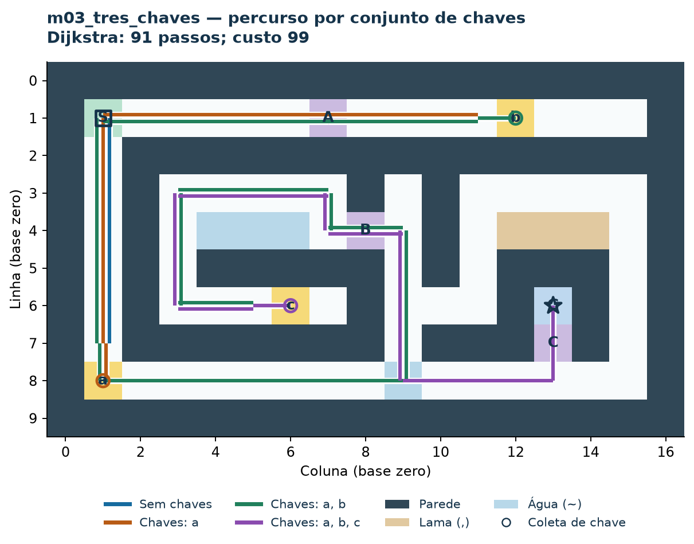

Figura 1. Caminho de menor custo no m03. A cor muda conforme o inventário; chaves impõem a sequência a, b, c. Fonte: resultados.json e percurso_m03.json.

A visualização desenha a grade, os símbolos e a sequência do trajeto. Repetir a mesma casa depois da coleta não é redundância: a posição pode representar outro vértice em G_est. A porta liberada explica a necessidade de retornar por corredores já visitados.

O menor custo é 99 em 91 passos. O caminho BFS tem 87 passos e custo 119. Assim, a exigência de chaves e os custos de terreno são decisões distintas: primeiro se modelam os movimentos permitidos; depois se escolhe qual função minimizar.

Limite visual: trechos que passam pela mesma casa podem se sobrepor. A conferência estado a estado deve usar percurso_m03.json ou o HTML interativo, que explicita chaves, consumo e custo acumulado.

## 12. Percurso de menor custo no m08

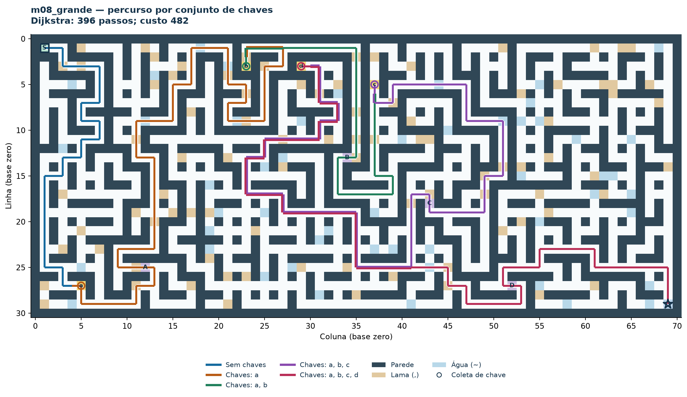

Figura 2. Percurso no mapa m08 (31 × 71), com quatro chaves. A legenda identifica as fases do inventário. Fonte: percurso_m08.json.

O caminho de menor custo tem 396 passos e custo 482. BFS encontra 392 passos e custo 524. A exploração alcança 5 camadas, somando 2919 estados físicos e 6364 arcos físicos.

Este mapa mostra por que a geração por exploração evita combinações artificiais: embora existam 1169 casas livres, só 15.61% do teto teórico é alcançável. A maior parte das combinações de inventário não existe nas posições dadas pelas portas.

A figura preserva o percurso geral. Para ampliar símbolos e consultar cada visita, abra o PNG original ou o HTML offline. A lista completa de transições é gerada no CSV de arestas; a sequência ótima é registrada no JSON.

## 13. Camadas do grafo de estados do m02

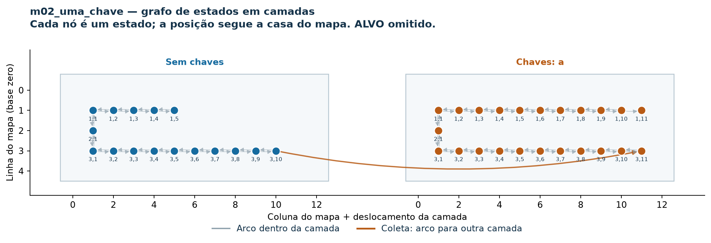

Figura 3. Camadas por inventário de chaves no m02; o arco destacado muda do conjunto vazio para {a}. Fonte: camadas.json e resultados.json.

A camada sem a tem 16 estados e 30 arcos internos. A camada com a tem 23 estados e 43 arcos internos. A coleta da chave liga as camadas e completa os 74 arcos físicos.

O jogador não volta à camada vazia, pois chaves não são gastas. Pode, porém, retornar à posição inicial com a e atravessar a porta. Esse retorno espacial é um novo estado e não uma restauração do inventário antigo.

O desenho separa os conjuntos de chaves para mostrar a mudança de regra de acesso. A mesma chave já presente não abre uma terceira camada. Os graus e densidades são calculados no subgrafo induzido de cada camada, sem o arco de ligação.

## 14. Árvore BFS de estados do m02

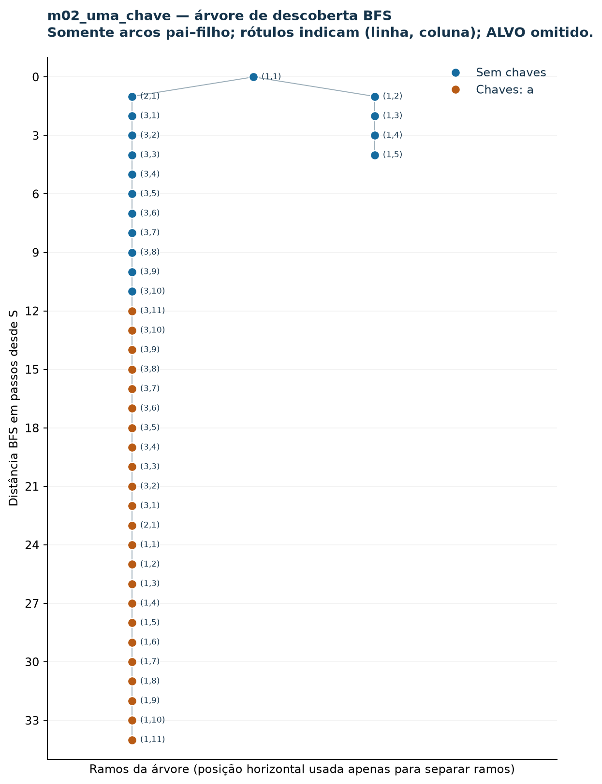

Figura 4. Árvore BFS do m02 com níveis. Cada ligação é um predecessor de primeira descoberta; não representa todos os arcos do grafo.

A árvore organiza estados por distância em arcos a partir do início. O caminho até G tem 34 movimentos físicos; ALVO adiciona um arco virtual. Estados da mesma posição em inventários diferentes permanecem com rótulos diferentes. Arcos fora da árvore continuam presentes no CSV, mas são omitidos para preservar legibilidade.

## 15. Heatmap da multiplicidade no m08

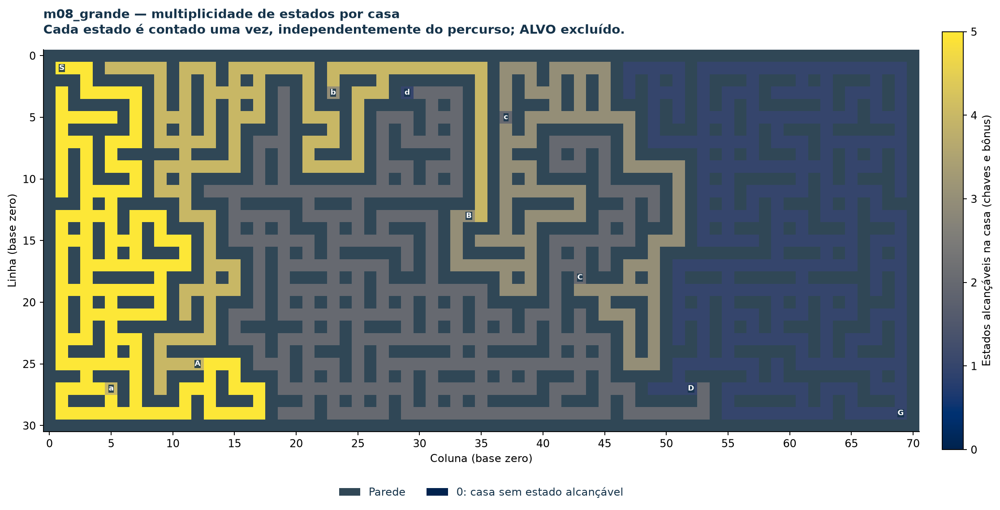

Figura 5. Multiplicidade de estados por casa no m08. A escala de cor conta visitas possíveis com memórias distintas, não frequência de uso por jogadores.

O máximo de 5 estados ocorre em 165 casas. Essas posições são alcançáveis antes e depois das quatro coletas sucessivas. A cor torna visível onde a mesma geometria se repete em mais camadas.

A multiplicidade é calculada contando os rótulos físicos por par (linha,coluna), incluindo todas as memórias alcançáveis; ALVO não pertence à grade. Não é uma estimativa probabilística de permanência nem de número de passagens no caminho ótimo.

### O que a Parte 1 permite concluir

A geometria sozinha não resolve o exercício. Inventário monotônico impede falsos ciclos de bônus, enquanto fontes permanentes podem gerar ciclos realmente negativos. BFS, Dijkstra e Bellman-Ford respondem a perguntas diferentes e DFS descreve a estrutura de exploração. Término em G, movimentos dirigidos e o tratamento de ALVO são necessários para manter contagens e respostas coerentes.

## 16. Parte 2: fonte, pergunta e qualidade

Pergunta: como o alcance dirigido varia entre fontes, como se distribuem os sinais das avaliações e em quais modelos existe um saldo mínimo finito? O domínio é a rede histórica de avaliações Bitcoin Alpha, disponibilizada pelo Stanford SNAP.

Fonte: https://snap.stanford.edu/data/soc-sign-bitcoin-alpha.html. Artigo de referência: Kumar et al., Edge Weight Prediction in Weighted Signed Networks, IEEE ICDM, 2016. A aprovação do uso foi informada por Artur; não foi fornecida a aprovação formal neste material.

| Aspecto | Resultado ou significado |
| --- | --- |
| Arquivo e versão | data/dataset_parte2/bitcoinalpha.csv. CSV recebido reconhecido pelo SHA-256: 24185 registros/3782 usuários; SNAP original tem 24186/3783. A comparação desta cópia foi documentada; não foi reinserido o registro ausente. |
| Tipo / dimensão | Dirigido, ponderado: 3782 nós e 24185 arcos. |
| Campos | SOURCE emissor; TARGET receptor; RATING avaliação discreta de -10 a +10; TIME segundos Unix. |
| Intervalo UTC | 2010-11-08T05:00:00+00:00 a 2016-01-22T05:00:00+00:00 |
| Sinais | 22649 positivos; 1536 negativos; 0 zeros. |
| Rating | Mínimo -10; máximo 10; média 1.4636; mediana 1. |
| Integridade | Ausências por campo: {'SOURCE': 0, 'TARGET': 0, 'RATING': 0, 'TIME': 0}; pares repetidos 0; laços 0. |
| Estrutura | Densidade 0.001691; 83.21% dos arcos têm reverso. |

SHA-256 do CSV recebido: d2f121d67f325ba2dfbbf0e9708843d7c9b0f898494957fb6b1b239db5150c8a

CSV recebido reconhecido pelo SHA-256: 24185 registros/3782 usuários; SNAP original tem 24186/3783. A comparação desta cópia foi documentada; não foi reinserido o registro ausente. Zero células vazias não prova completude social ou mecanismo de ausência. IDs são categorias nominais; a ordem numérica não mede importância. Ratings são ordinais da plataforma; somá-los é uma convenção operacional, sem unidade psicológica garantida.

Os quatro pilares são cobertos por estrutura/tipos e integridade; distribuição dos ratings e graus; relações entre emissão, recepção, negativas e tempo; e identificação de outliers sem exclusão automática. Relações observadas não demonstram causalidade. Os valores extremos de grau e avaliações foram mantidos como dados, e não tratados como erros por serem extremos.

## 17. Travessias a partir de três fontes

Escolha determinística: maior grau de saída; maior quantidade de negativas emitidas; posição mediana entre usuários com saída. Empates usam ID e duplicações são substituídas pelo próximo maior grau. O critério produz fontes 1, 8, 1359. BFS/DFS usam direções originais e ignoram os pesos.

| Fonte | Alcançáveis | Inalcançáveis | Profundidade | DFS: árvore / retorno / avanço / cruzamento |
| --- | --- | --- | --- | --- |
| 1 | 3748 | 34 | 5 | 3747 / 11267 / 8764 / 362 |
| 8 | 3748 | 34 | 5 | 3747 / 11250 / 8777 / 366 |
| 1359 | 3748 | 34 | 7 | 3747 / 11264 / 8762 / 367 |

| Fonte | Quantidade por camada BFS (da camada zero em diante) |
| --- | --- |
| 1 | 0: 1; 1: 490; 2: 1429; 3: 1651; 4: 166; 5: 11 |
| 8 | 0: 1; 1: 259; 2: 1412; 3: 1815; 4: 246; 5: 15 |
| 1359 | 0: 1; 1: 2; 2: 299; 3: 2059; 4: 1224; 5: 145; 6: 17; 7: 1 |

### Ordens de descoberta: primeiros doze

Fonte 1: BFS [1, 160, 1028, 309, 11, 594, 1316, 1392, 1583, 888, 637, 1520]; DFS [1, 160, 18, 11, 2, 37, 4, 302, 60, 14, 9, 20].

Fonte 8: BFS [8, 2, 3, 5, 6, 7, 521, 600, 396, 306, 25, 7380]; DFS [8, 2, 1, 160, 18, 11, 3, 5, 67, 4, 302, 60].

Fonte 1359: BFS [1359, 3, 42, 5, 92, 6, 207, 123, 287, 103, 34, 56]; DFS [1359, 3, 5, 2, 1, 160, 18, 11, 4, 302, 60, 14].

As ordens completas, pais, tempos DFS, classificações e camadas estão em parte2_report.json. A ordem respeita a sequência de arcos do arquivo recebido. BFS visita por menor distância em arcos; DFS aprofunda ramos. Nenhuma ordem é ranking de reputação.

Resultados por fonte: 1 alcança 3748, profundidade 5, ciclo DFS sim; 8 alcança 3748, profundidade 5, ciclo DFS sim; 1359 alcança 3748, profundidade 7, ciclo DFS sim. As distâncias e ordens diferem. Arcos de retorno testemunham ciclos alcançáveis, mas o sinal do ciclo exige os pesos e não pode ser inferido somente por DFS.

A ausência de caminho dirigido registrada na tabela é relativa à fonte e ao arquivo. Ela não prova ausência de relação social, de perfil ativo ou de vínculo fora dos registros.

## 18. Pesos, pares e casos de Bellman-Ford

Modelo original: peso = RATING. Minimizar sua soma procura valores mais negativos e acumula desconfiança; não é recomendação de confiança. Para Dijkstra, custo = 10-RATING, entre 0 e 20. Para um percurso com k arcos, soma(10-rating)=10k-soma(rating). O termo por arco muda o objetivo quando k varia; a transformação não preserva mínimos originais.

Para cada fonte, destinos foram selecionados nas posições 25%, 65% e 100% da ordenação (distância BFS, ID), sem repetição. São 9 pares, acima dos cinco exigidos. As buscas Dijkstra percorrem a fonte completa e depois reconstroem o destino.

| Par | Arcos BFS | Arcos Dijk. | Custo 10-r do BFS | Custo 10-r Dijk. | Soma rating Dijk. |
| --- | --- | --- | --- | --- | --- |
| 1→638 | 2 | 3 | 17 | 11 | 19 |
| 1→1656 | 3 | 5 | 23 | 21 | 29 |
| 1→7450 | 5 | 8 | 51 | 49 | 31 |
| 8→1219 | 2 | 4 | 18 | 13 | 27 |
| 8→1973 | 3 | 5 | 22 | 21 | 29 |
| 8→7450 | 5 | 10 | 53 | 50 | 50 |
| 1359→1021 | 3 | 11 | 25 | 23 | 87 |
| 1359→674 | 4 | 6 | 28 | 20 | 40 |
| 1359→2666 | 7 | 9 | 55 | 49 | 41 |

Dijkstra usa mais arcos em 9 pares e custo transformado estritamente menor em 9. Por exemplo, 1→638 passa por [1, 142, 7, 638], custo 11, enquanto BFS usa [1, 22, 638], custo 17. Isso compara objetivos explicitados, não corretude de algoritmos para uma mesma função de custo.

### Controle com negativos e mínimo finito

O controle mantém somente arcos reais que avançam estritamente de camada BFS: 3748 nós, 7261 arcos, 547 negativos; 16924 arcos retirados. A camada inteira cresce em cada arco e não pode retornar ao início de um ciclo. Bellman-Ford da fonte 1 encontra [1, 95, 125, 7502, 7363], custo -20, sem ciclo negativo. O recorte muda a rede; não resolve os mínimos da rede original.

### Caso original com ciclo negativo

Da fonte 2, BF encontra [7565, 7553, 7565], custo -20. Cada arco foi conferido no CSV: 7565→7553: -10; 7553→7565: -10. São 3748 vértices sem mínimo finito, 34 inalcançáveis e 0 com mínimo finito. Repetir o ciclo soma -20 a cada volta; não representa lucro financeiro.

## 19. Desempenho por tarefa obrigatória

Cada média e mediana abaixo usa 5 execuções. A fonte e o destino determinam a tarefa. Dijkstra inclui busca completa da fonte e reconstrução do par; não é medição de parada antecipada no destino. BFS/DFS são medidos separadamente para cada fonte.

| Algoritmo | Fonte | Destino | Caso | Média (s) | Mediana (s) |
| --- | --- | --- | --- | --- | --- |
| BFS | 1 | - | travessia original | 0.0019190 | 0.0018418 |
| DFS | 1 | - | travessia original | 0.0053782 | 0.0052862 |
| BFS | 8 | - | travessia original | 0.0018624 | 0.0018546 |
| DFS | 8 | - | travessia original | 0.0051339 | 0.0051177 |
| BFS | 1359 | - | travessia original | 0.0017936 | 0.0017912 |
| DFS | 1359 | - | travessia original | 0.0050693 | 0.0050548 |
| Dijkstra | 1 | 638 | par 10-rating | 0.0052083 | 0.0052119 |
| Dijkstra | 1 | 1656 | par 10-rating | 0.0055408 | 0.0053328 |
| Dijkstra | 1 | 7450 | par 10-rating | 0.0055183 | 0.0054678 |
| Dijkstra | 8 | 1219 | par 10-rating | 0.0061185 | 0.0060806 |
| Dijkstra | 8 | 1973 | par 10-rating | 0.0059159 | 0.0056522 |
| Dijkstra | 8 | 7450 | par 10-rating | 0.0056469 | 0.0051701 |
| Dijkstra | 1359 | 1021 | par 10-rating | 0.0052695 | 0.0051137 |
| Dijkstra | 1359 | 674 | par 10-rating | 0.0055030 | 0.0054617 |
| Dijkstra | 1359 | 2666 | par 10-rating | 0.0054556 | 0.0055876 |
| Bellman-Ford | 1 | 7363 | DAG | 0.0049821 | 0.0046141 |
| Bellman-Ford | 2 | - | ciclo original | 6.4059060 | 6.4036144 |

O caso Bellman-Ford na rede original reutiliza as 5 medições de mesma fonte/tarefa do benchmark de 100%; não conta novas amostras adicionais. measurement_origin e as séries individuais preservam essa origem em case_benchmarks.csv e no JSON.

Ambiente: Python 3.12.14 (CPython), Windows-11-10.0.26300-SP0, Intel64 Family 6 Model 170 Stepping 4, GenuineIntel. Cronômetro: time.perf_counter. Registro UTC: 2026-11-01T04:51:16.781036+00:00.

O intervalo medido inclui construir o resultado da busca e detectar/propagar ciclos. Exclui leitura do CSV, construção dos modelos e renderização. Não houve descarte de aquecimento, remoção de outlier temporal ou timeout oculto. Carga de fundo não foi controlada; estes números não são previsão para outra máquina.

## 20. Escalabilidade e complexidades

Subgrafos induzidos aninhados foram criados por IDs ordenados, embaralhados com random.Random(42), e prefixos de 10%, 50% e 100%. Foram mantidos nós isolados e todos os arcos entre nós selecionados. Não houve amostragem direta de arestas.

| Nós % | V | E | Algoritmo | Fonte | Média (s) | Mediana (s) | Mín.-máx. (s) |
| --- | --- | --- | --- | --- | --- | --- | --- |
| 10% | 378 | 332 | BFS | 1 | 0.000058 | 0.000056 | 0.000052-0.000069 |
| 10% | 378 | 332 | DFS | 1 | 0.000119 | 0.000114 | 0.000107-0.000133 |
| 10% | 378 | 332 | Dijkstra | 1 | 0.000140 | 0.000133 | 0.000130-0.000164 |
| 10% | 378 | 332 | Bellman-Ford | 145 | 0.010350 | 0.010435 | 0.009867-0.010552 |
| 50% | 1891 | 6368 | BFS | 1 | 0.001711 | 0.001768 | 0.001579-0.001820 |
| 50% | 1891 | 6368 | DFS | 1 | 0.004176 | 0.004309 | 0.002837-0.005029 |
| 50% | 1891 | 6368 | Dijkstra | 1 | 0.004335 | 0.004336 | 0.003519-0.005082 |
| 50% | 1891 | 6368 | Bellman-Ford | 6 | 1.129084 | 0.945958 | 0.800847-1.624267 |
| 100% | 3782 | 24185 | BFS | 1 | 0.001962 | 0.001879 | 0.001733-0.002347 |
| 100% | 3782 | 24185 | DFS | 1 | 0.005918 | 0.005866 | 0.005144-0.007215 |
| 100% | 3782 | 24185 | Dijkstra | 1 | 0.006303 | 0.005871 | 0.005438-0.007545 |
| 100% | 3782 | 24185 | Bellman-Ford | 2 | 6.405906 | 6.403614 | 6.001397-6.762021 |

Fontes BFS/DFS/Dijkstra: maior saída do subgrafo. BF prefere menor ID participante de ciclo recíproco negativo; na ausência usa maior saída. As fontes diferem conforme a tarefa, portanto o gráfico não deve ser lido como competição universal com trabalho idêntico.

| Algoritmo | Complexidade de tempo | Leitura dos resultados |
| --- | --- | --- |
| BFS / DFS | O(V+E) | Varrem a estrutura alcançável; saída e classificação também custam tempo. |
| Dijkstra com heap | O((V+E) log V) | Relaxamentos e fila de prioridades, somente no modelo 10-rating. |
| Bellman-Ford | O(VE) | Varreduras repetidas; ciclos negativos exigem detecção e propagação. |

De 378 para 3782 nós, os arcos crescem de 332 para 24185, não linearmente com a fração de nós. O crescimento mais forte de BF é compatível com seu pior caso, mas três tamanhos, 5 execuções e subgrafos diferentes não demonstram empiricamente uma lei assintótica. A mediana reduz a influência descritiva de execuções lentas; a média exigida e todos os valores são preservados.

## 21. Exploração: distribuição e relações de grau

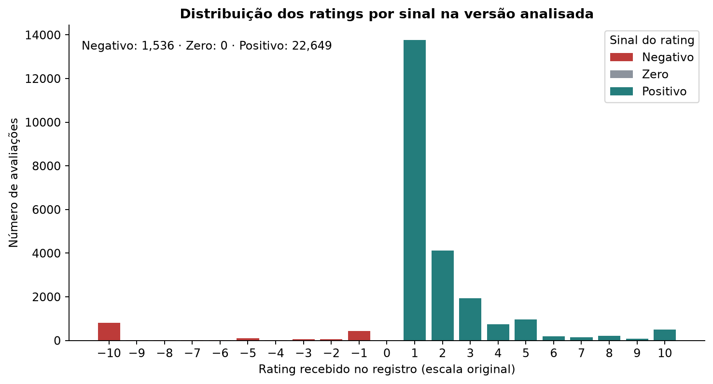

Figura 6. Distribuição de todos os ratings do CSV recebido, incluindo frequências zero na escala. Cores indicam sinal, não probabilidade de confiança.

Mostra a contagem em cada valor de -10 a 10, inclusive valores sem registros. Há 22649 avaliações positivas (93.65%), 1536 negativas e 0 zeros. Barras são adequadas à escala discreta e deixam frequências nulas visíveis. As três cores e a legenda identificam o sinal, e o eixo cobre a escala completa. A frequência dos sinais não autoriza concluir que a rede inteira é confiável.

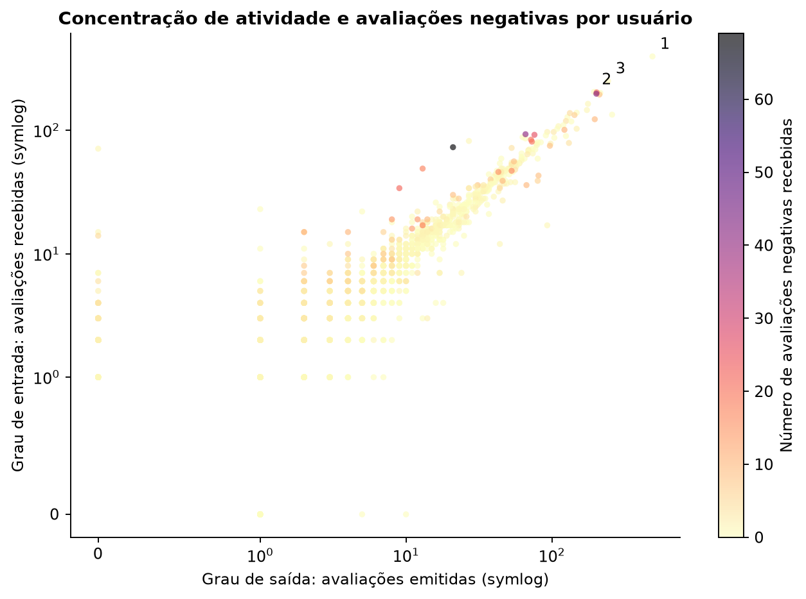

Figura 7. Cada ponto é um usuário. Escala symlog mantém zeros. Rótulos identificam os três maiores graus de entrada; sobreposição pode esconder pontos.

Cada ponto combina grau de saída (emissor), grau de entrada (receptor) e cor para o número de negativas recebidas: três variáveis derivadas dos registros. O usuário 1 tem maior entrada (397); 7604 recebe 69 negativas em 73 avaliações. Dispersão permite procurar concentração, associação e casos fora da tendência; symlog acomoda zeros e uma faixa ampla. Os rótulos destacam maiores entradas, não IDs numericamente maiores. A barra de cores explicita as contagens de negativas. A cor é contagem absoluta, portanto também depende da exposição; não é taxa de risco e a relação não prova causalidade. Pontos sobrepostos podem ocultar usuários.

## 22. Exploração: alcance e tempo

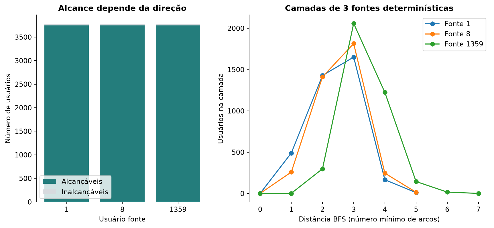

Figura 8. BFS ignora rating. A fonte conta na camada zero. Ausência de caminho dirigido não implica ausência de relação social fora dos registros.

As barras separam alcançáveis de inalcançáveis, e as linhas mostram quantos usuários surgem em cada camada. Resultados desta versão: fonte 1: 3748 alcançáveis, 34 inalcançáveis, profundidade máxima 5; fonte 8: 3748 alcançáveis, 34 inalcançáveis, profundidade máxima 5; fonte 1359: 3748 alcançáveis, 34 inalcançáveis, profundidade máxima 7. Barras com parte/todo e linhas em distâncias inteiras facilitam comparar volume e distribuição. As legendas distinguem os conjuntos e as fontes. Destaques são os vértices inalcançáveis e as camadas mais distantes de cada fonte, com contagens descritas acima. BFS ignora rating, e ausência de caminho não prova ausência de relação fora do arquivo.

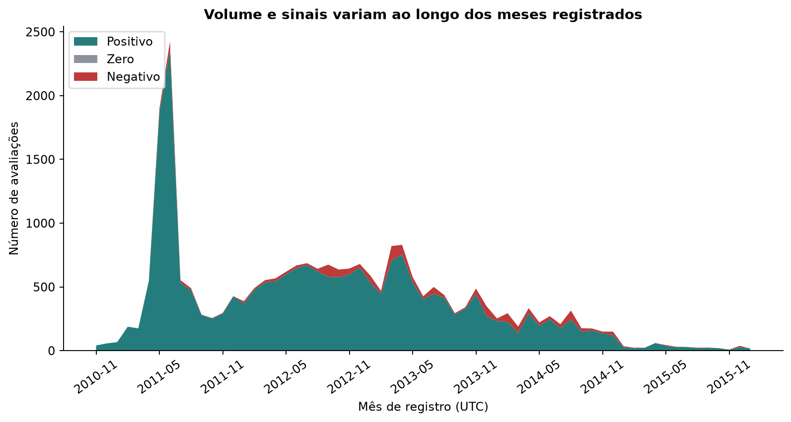

Figura 9. Agregação mensal UTC dos registros disponíveis. Não estima usuários ativos, causalidade ou evolução de confiança individual.

A área empilhada separa volumes mensais positivos, negativos e zeros, expondo variação temporal de contagens e sinais. O pico total ocorre em 2011-06 com 2424 registros. A área evidencia composição e volume; meses ordenados permitem localizar o pico, sem usar ID como tempo. O destaque não identifica a causa, não conta usuários ativos e não acompanha a mudança de opinião de uma mesma pessoa. A categoria zero permanece identificada na legenda e tem 0 registros nesta versão.

As distribuições têm papéis diferentes: quantidade de avaliações não é quantidade de pessoas, alcance dirigido não mede confiança e contagem de negativas depende da exposição. A exploração multivariada usa entrada, saída, negativas recebidas e mês, com IDs tratados apenas como identificadores.

## 23. Da exploração à explicação: objetivos de caminho

A exploração encontrou predominância de ratings positivos, mas também negativos e concentração de avaliações. A mesma rede permite perguntar por alcance ou por custo. Para comunicar essa distinção, o primeiro gráfico explanatório compara os mesmos pares sob duas funções objetivas e expõe o número de arcos e o custo transformado.

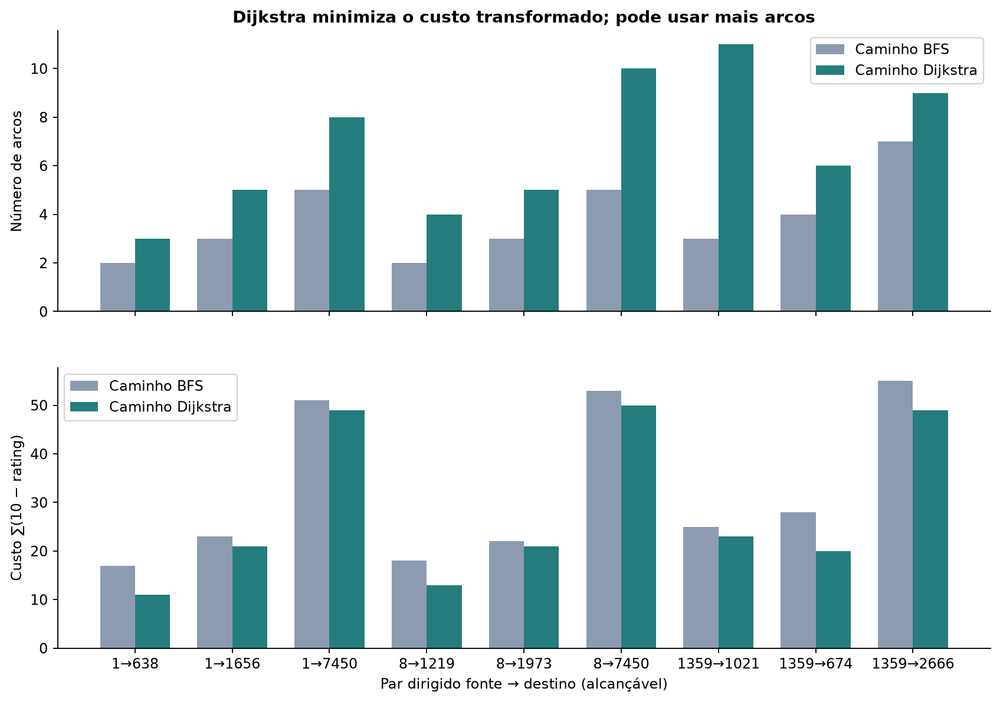

Figura 10. Comparação nos mesmos pares. BFS minimiza arcos; Dijkstra minimiza ∑(10-rating). O termo 10 é cobrado a cada arco: não equivale a maximizar a soma de ratings quando o número de arcos varia.

Duas barras por par comparam BFS e Dijkstra em número de arcos e em soma de 10-rating, em painéis com as mesmas categorias. Dijkstra usa mais arcos em 9 dos 9 pares; obtém custo transformado estritamente menor em 9 e igual em 0. Barras agrupadas facilitam comparação par a par; os dois painéis mostram a relação observada entre número de arcos e custo. O destaque é que minimizar quantidade de arcos e custo transformado são objetivos distintos, mesmo quando os resultados coincidem. Como ∑(10-rating)=10k−∑rating, variar k impede tratar a transformação como equivalente ao mínimo original ou a confiança transitiva.

A seleção de pares é determinística e não pretende representar todos os caminhos da rede. Barras lado a lado e categorias iguais permitem comparar o mesmo par. Painéis separados evitam misturar unidades; a cor distingue o algoritmo/objetivo. A mensagem é uma troca verificável entre arcos e custo, sem recomendar confiança transitiva.

## 24. Da exploração à explicação: existência do mínimo

A minoria de ratings negativos observada na exploratória motivou verificar se a soma mínima é bem definida. A história principal é local e algorítmica: 2 arcos reais, somando -20, bastam para impedir mínimo finito na região alcançável após o ciclo. Uma rede majoritariamente positiva ainda pode ter esse problema.

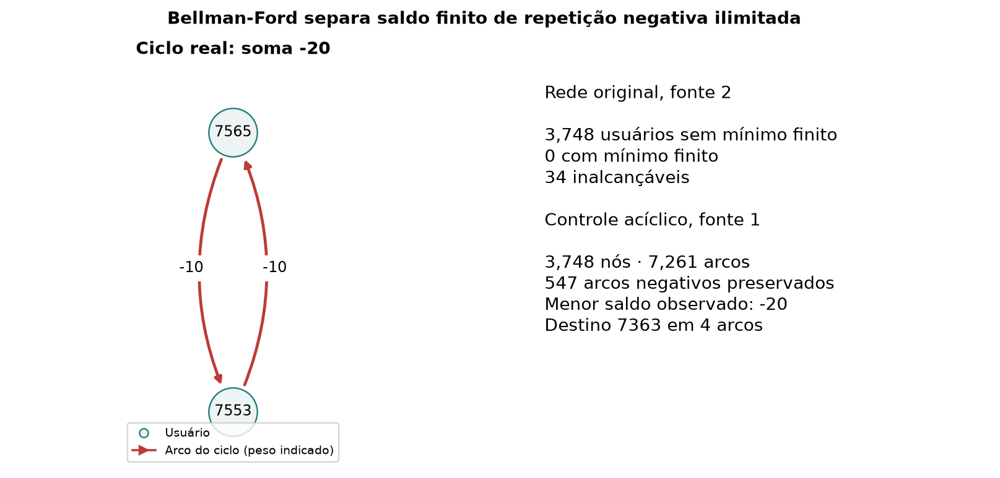

Figura 11. O ciclo foi validado arco a arco no CSV recebido. O controle retira arcos que não avançam nas camadas BFS; não descreve a rede original como acíclica.

O diagrama mostra o ciclo real 7565 → 7553 → 7565, com soma -20, e o painel contrasta seus 3748 usuários afetados com o controle DAG de 3748 nós/7261 arcos, que preserva 547 avaliações negativas. Um desenho local com setas, legenda e pesos permite conferir a direção e a soma sem esconder o ciclo no desenho da rede inteira; o texto distingue finito, inalcançável e sem mínimo. Repetir a soma negativa -20 reduz a soma ilimitadamente. O controle remove retornos entre camadas e não implica que a rede original seja acíclica; não há interpretação financeira.

O diagrama escolhe somente os vértices e pesos do ciclo conferido, para que direção e soma sejam verificáveis. O painel de controle distingue a rede original de uma rede com arcos removidos e camada crescente. Cor e posição separam os dois casos; números identificam nós/arcos e negativos preservados.

A figura responde à terceira parte da pergunta: no controle acíclico, os destinos alcançados têm soma mínima finita apesar dos pesos negativos; na rede original, os 3748 vértices afetados da fonte 2 não têm mínimo finito. Destinos inalcançáveis continuam sendo uma terceira situação distinta.

## 25. Comparação visual do custo computacional

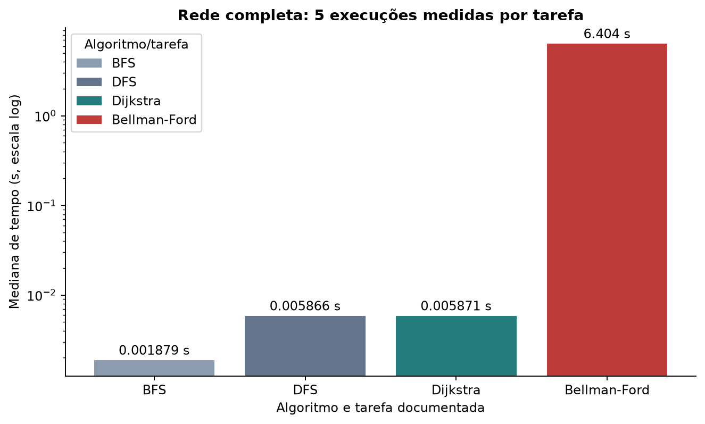

Figura 12. Tempos do mesmo ambiente, excluindo leitura/construção/figuras. Tarefas e pesos diferem: BFS/DFS alcance, Dijkstra custo transformado, BF saldo original e ciclos; não é ranking de algoritmos equivalentes.

As barras mostram medianas das 5 execuções locais de cada tarefa. BF tem mediana 6.403614s, pois precisa detectar/propagar ciclos no modelo original; BFS/DFS/Dijkstra realizam tarefas distintas. A escala log permite visualizar ordens de grandeza sem ocultar tempos pequenos, os rótulos mostram segundos e a legenda identifica cada algoritmo/tarefa. O destaque é o custo medido do caso cíclico, não uma classificação universal de algoritmos. Médias, dispersão, fontes e tarefas constam das tabelas, impedindo confundir objetivos diferentes.

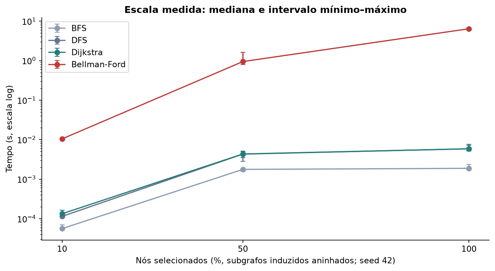

Figura 13. Amostra uniforme de nós, mantendo inclusive isolados e todas as arestas induzidas. Contagens reais e tempos individuais estão no JSON/CSV. Três tamanhos não provam complexidade assintótica.

As linhas usam medianas e barras de mínimo–máximo dos subgrafos induzidos com seed 42. Contagens reais por fração de nós (nós/arcos): 10%: 378/332; 50%: 1891/6368; 100%: 3782/24185. A fração de nós não fixa a fração de arcos, por isso ambas as contagens são informadas. Linhas evidenciam a mudança medida, e barras mostram a variação sem pressupor distribuição dos tempos. A escala log mantém as curvas legíveis, e a legenda identifica os algoritmos. Fontes e tarefas são documentadas; estes tamanhos, 5 repetições e carga de fundo não demonstram uma lei assintótica nem desempenho em outra máquina.

As figuras usam medianas e intervalos, enquanto as tabelas anteriores registram também as médias exigidas. Escalas logarítmicas permitem mostrar tempos muito diferentes, e os eixos/rótulos mantêm a unidade segundo. Leituras e preparação dos modelos não estão nos tempos.

## 26. Discussão, limites e participação

Resposta à pergunta: alcance dirigido (fonte 1: 3748/3782; fonte 8: 3748/3782; fonte 1359: 3748/3782), com camadas e profundidades específicas de cada fonte. As avaliações positivas são 93.65% dos registros e as negativas 6.35%; a minoria negativa forma um ciclo real de soma -20. No modelo original da fonte 2, 3748 destinos não têm mínimo finito. No controle DAG, conservar 547 pesos negativos ainda permite resposta finita porque não há ciclo. Dijkstra responde a outro objetivo, a soma de 10-rating.

Adequação: BFS para menor número de relações; DFS para estrutura e ciclos; Dijkstra para custos não negativos bem definidos; Bellman-Ford para negativos e diagnóstico de ausência de mínimo. A confiabilidade do modelo vem antes da velocidade. Menor saldo de avaliações não mede confiança, e os dados históricos não sustentam causalidade, identidade ou generalização a outras plataformas.

Limites de versão: CSV recebido reconhecido pelo SHA-256: 24185 registros/3782 usuários; SNAP original tem 24186/3783. A comparação desta cópia foi documentada; não foi reinserido o registro ausente. Aprovação é informação fornecida, sem documento anexado. Zero ausências não prova completude. Outliers foram mantidos. Só três tamanhos e 5 execuções não comprovam complexidade assintótica. Resultados calculados não comprovam domínio dos integrantes nem ensaio de defesa.

### Matriz de contribuição comprovada nesta produção

| Pacote | Produção observada | Dono humano | Revisor humano |
| --- | --- | --- | --- |
| Modelagem e algoritmos | Geração assistida integralmente por IA | Não comprovado | Não comprovado |
| Mapas, soluções e testes | Geração/execução assistidas por IA | Não comprovado | Não comprovado |
| Dataset, análise e figuras | Arquivo recebido; processamento e análise por IA | Não comprovado | Não comprovado |
| Manual, relatório e declaração | Geração assistida integralmente por IA | Não comprovado | Não comprovado |

Os cinco nomes identificam o grupo informado. Não foram atribuídos commits, tarefas, revisões, assinaturas ou reflexão pessoal sem evidência. A exigência de cada integrante atuar em ao menos dois pacotes não está comprovada por este relatório. A produção com IA inclui usos proibidos; a minuta anexa os registra e deixa cinco assinaturas vazias.

### Referências e reprodutibilidade

Enunciado: docs/referencias/Projeto_Final_TEORIADOSGRAFOS262-1.pdf. Rubrica: docs/referencias/CRITERIOS_PROJETO_2026-2.pdf. Fonte: Stanford SNAP, Bitcoin Alpha; Kumar et al. (ICDM 2016). Evidências completas: out/parte1/ e out/parte2/. O comando python -m src.cli --report recompõe Markdown, PDFs e roteiro a partir desses resultados, sem repetir medições.
